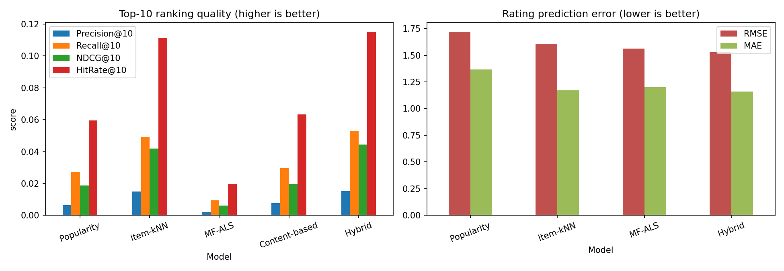

# -Amazon-Recommendation-System

This project compares several recommender system approaches on the **Book** dataset. Every model is trained on the same split and evaluated with the same metrics, so the comparison is fair.

It was done as part of the Machine Learning Tasks:
- **Task 1:** analysis of Amazon's recommendation system (separate PDF report with diagrams).
- **Task 2:** implementation and comparison of recommender paradigms (this repository).

## Models

| Model | Type | Idea |
|---|---|---|
| Popularity | Baseline | Recommends the most-rated books to everyone |
| Item-kNN | Collaborative filtering | Finds books that the same users rated, using cosine similarity with shrinkage for books with few common raters |
| MF-ALS | Matrix factorisation | User and book biases plus latent factors learned with alternating least squares |
| Content-based | Content filtering | TF-IDF on title, author and publisher, plus a taste profile built from each user's ratings |
| Hybrid | Hybrid | Weighted blend of the standardised scores of the models above |

## Dataset

Book-Crossing, three files: `Books.csv`, `Ratings.csv`, `Users.csv`.

- In `Ratings.csv`, a rating of `0` means the user interacted with a book without rating it. These 716,109 rows were dropped, leaving 433,671 explicit ratings (1 to 10).
- Users and books with fewer than 5 ratings were removed.
- Final data: **7,032 users, 9,439 books, 118,784 ratings** (density about 0.18%).
- Split: 80% train / 20% test, done per user (95,247 train and 23,537 test ratings).
- A test book counts as "liked" when its rating is 8 or higher.
- `Users.csv` is not used by the models.

The dataset is not included in this repository because of its size. Download it from the link given in the task and put the three CSV files in a folder called `books_data`.

## How to run

```bash
pip install -r requirements.txt
```

Open `recsys_compare.py` and set `DATA_FOLDER` near the top to the folder that has the three CSV files. Then run:

```bash
python recsys_compare.py
```

You can also pass everything on the command line:

```bash
python recsys_compare.py --data books_data --rel-threshold 8 --out results
```

To test the pipeline quickly on generated fake data:

```bash
python recsys_compare.py --demo
```

The full run takes about a minute.

### Outputs (in `results/`)
- `metrics.csv`: all metrics for every model
- `model_comparison.png`: charts of ranking quality and rating error
- `sample_recommendations.txt`: example recommendations for a few users

## Evaluation

| Metric | What it measures |
|---|---|
| RMSE, MAE | Error when predicting the rating a user gives (lower is better) |
| Precision@K, Recall@K | Share of the top-K list that is liked, and share of liked books that were found |
| NDCG@K | Ranking quality, rewarding liked books that appear higher in the list |
| HitRate@K | Share of users who get at least one liked book in their top-K |
| Coverage | Share of the catalogue that is ever recommended |

K is 5, 10 and 20. Books a user already rated in training are never recommended. Hyper-parameters (number of neighbours for Item-kNN, number of factors for ALS) were chosen on a validation slice taken only from the training data, never from the test set.

## Results

Test set, top-10 lists (liked = rating of 8 or more):

| Model | RMSE | MAE | Precision@10 | Recall@10 | NDCG@10 | HitRate@10 | Coverage |
|---|---|---|---|---|---|---|---|
| Popularity | 1.7205 | 1.3647 | 0.0063 | 0.0273 | 0.0186 | 0.0596 | 0.0020 |
| Item-kNN (k=20) | 1.6074 | 1.1726 | 0.0149 | 0.0491 | 0.0418 | 0.1114 | 0.8502 |
| MF-ALS (40 factors) | 1.5639 | 1.2015 | 0.0020 | 0.0095 | 0.0063 | 0.0197 | 0.3323 |
| Content-based | - | - | 0.0156 | 0.0624 | 0.0414 | 0.1253 | 0.8233 |
| **Hybrid** | **1.5290** | **1.1609** | **0.0171** | 0.0592 | **0.0485** | **0.1294** | 0.8538 |

Ranking metrics are averaged over 5,340 users who have at least one liked book in the test set. Content-based only ranks books, so it has no RMSE or MAE.



## What the results show

- **Personalised models clearly beat popularity.** Item-kNN, Content-based and Hybrid rank about 2 to 3 times better than the popularity baseline. Popularity shows the same bestsellers to everyone and covers only 0.2% of the catalogue, while the others cover over 80%.
- **The hybrid is the best overall.** It has the lowest rating error and the highest NDCG@10 and HitRate@10.
- **Low rating error does not guarantee a good top-N list.** MF-ALS predicts ratings better than popularity and Item-kNN, but its top-10 lists are poor. Ordering books by predicted rating favours obscure books with a few high ratings, and with data this sparse the latent factors are noisy.
- **Content features help on sparse data.** The content-based model never uses other users' ratings and still competes with Item-kNN.

## Limitations

- Only explicit ratings are used. The 716k unrated interactions could feed an implicit-feedback model in future work.
- Users and books that never appear in training are dropped from the test set, so cold start is not evaluated.
- One random split, no repeated runs, so small differences (for example Item-kNN versus Content-based) may not be significant.
- The ALS training loop is plain Python, so it would be slow on datasets with hundreds of thousands of users.

## Project structure

```
recsys_compare.py        main script (data loading, models, evaluation, plots)
requirements.txt         Python packages
README.md                this file
results/                 metrics.csv, model_comparison.png, sample_recommendations.txt
books_data/              the three dataset CSV files (not committed)
```

## Tech

Python, NumPy, pandas, SciPy, scikit-learn, Matplotlib.
